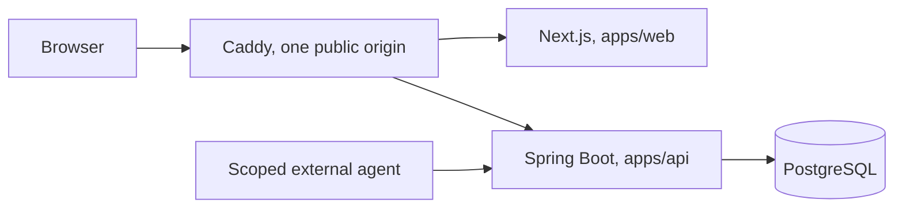

# Architecture overview

## Current state

- The existing Next.js application and Prisma schema are maintained outside this repository. They are used as migration evidence and are intentionally not committed here.
- `apps/api/` is the new Java 21 and Spring Boot 4.2.0 application. At present it connects to PostgreSQL and serves a public liveness endpoint at `GET /api/v1/health`.
- `apps/web/` has not been created yet.
- `infra/docker/compose.yaml` starts PostgreSQL. The API and web applications do not have container builds yet.

## Intended request flow

This is the planned deployment shape, not a description of services that are already running. Next.js owns presentation. The Spring Boot modular monolith owns identity, business authorization, ledger rules, approvals, imports, reporting, background jobs and persistence.

## Boundaries

- The browser and agents use the same versioned REST API. Accounting behavior is implemented once in Spring Boot.
- The frontend does not connect directly to PostgreSQL and does not implement accounting rules in Next.js route handlers or server actions.
- Backend packages are organized around business capabilities such as identity, businesses, ledger, approvals, imports, reporting and audit.
- Caddy will route `/api/*` to Spring Boot and other requests to Next.js. Database and management endpoints remain private.
- Docker Compose services may have separate containers on one VPS. They remain one application deployment, not microservices.

## Data and accounting invariants

- Monetary values use Java `BigDecimal` and explicitly sized PostgreSQL `NUMERIC` columns. JSON sends money and rates as decimal strings.
- Journal postings are balanced, business-scoped and atomic with audit writes. Posted entries are immutable; corrections use linked reversals.
- A business has a functional currency. Original currency, original amount, applied rate and functional-currency amount are retained.
- Imports create reviewable candidates and never post journals automatically.
- Schema changes are managed by Flyway. Hibernate validates the schema rather than changing it in normal environments.

The full requirements and rollout sequence are maintained in [AGENTS.md](../AGENTS.md) and the [migration roadmap](migration-roadmap.md).
