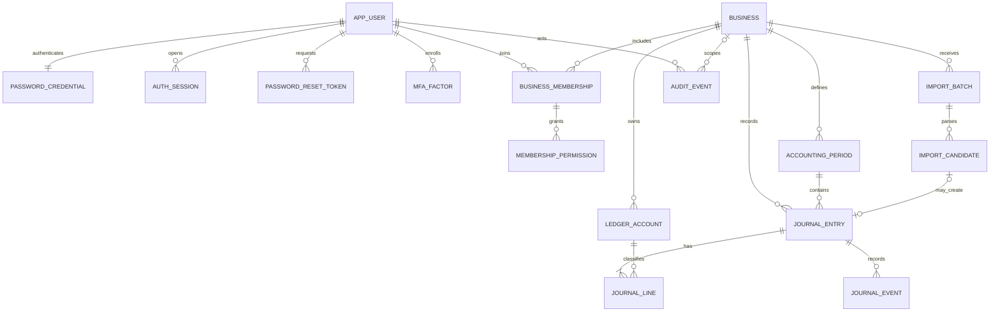

# Database architecture checkpoint

**Status: Accepted baseline, implementation in progress.** The first Flyway migration establishes user, business, membership, permission, currency-reference, and append-only audit tables. Credential/session behavior remains deferred to the auth port. Ledger tables remain deferred until amount/rate precision and related accounting policies are confirmed. No legacy data has been changed.

## Goals

- Give each business a durable, isolated accounting book while allowing a user to belong to multiple businesses.
- Make posted accounting history balanced, immutable through normal application operations, and auditable.
- Separate login identity, business membership, platform administration, and accounting ownership.
- Preserve source evidence for imports and migrations without treating imported data as trusted or already posted.
- Keep the first implementation understandable: one PostgreSQL database, one Spring Boot modular monolith, and explicit table ownership by module.

## Current schema problems to correct

The separately maintained legacy Prisma schema is useful migration evidence, but is not a target schema:

- `UserRole` mixes platform `ADMIN` with ordinary `USER`; `User[]` to `Business[]` has no explicit membership record, status, or business-scoped permissions.
- `Business.name` is globally unique, which prevents two unrelated businesses from using the same display name.
- Business, bank-account, transaction, ledger-entry, and user audit relationships include cascade-delete paths that can erase accounting history or attribution.
- `FinancialTransaction` and `LedgerEntry` do not define a journal posting lifecycle or a database-enforced balanced-entry invariant. A debit flag and decimal amount alone do not establish a complete double-entry ledger.
- Decimal precision and scale are not declared in the model. The `OTHER` currency value does not identify which currency was used or preserve an exchange rate.
- The business currency does not distinguish functional currency from an original transaction currency.
- `AuditLog` has generic entity fields without a target foreign key and is deleted with its user. `TransactionVersion` stores snapshots but does not replace immutable posted journal history.
- Reset-token storage and session expiry semantics need to be verified in legacy code before any account migration. The Prisma schema alone does not prove whether token values are hashed in the application.

## Structural decisions

### Database and module ownership

- Use one PostgreSQL database and one physical schema initially. Use explicit snake-case table names and keep ownership in Spring packages: `identity`, `businesses`, `ledger`, `imports`, `reporting`, `audit`, and `operations`.
- Keep Flyway as the sole schema owner. Hibernate validates the schema; it does not create or update production tables.
- Allow cross-module foreign keys for stable ownership boundaries such as business and user IDs. Keep business rules and repositories inside their owning module.
- Use a dedicated migration/database-owner role for DDL. The application runtime role must not own tables or run migrations. The current Compose database credentials are local-development scaffolding, not the final production role design.

### Keys, time, and tenant isolation

- Use native PostgreSQL `UUID` primary keys for users, businesses, and domain records. Generate IDs in the application with a cryptographically secure standard UUID generator. UUIDs are identifiers, not authorization checks.
- Store instants in `TIMESTAMPTZ` in UTC. Store accounting dates and period boundaries as `DATE`.
- Put `business_id` on every business-owned row, even when it could be derived through a parent. Add composite unique keys and foreign keys such as `(business_id, journal_entry_id)` and `(business_id, ledger_account_id)` so a row cannot link records from different businesses.
- Resolve membership and permissions in the application on every business read and write. Composite foreign keys are a second integrity boundary, not a replacement for authorization. PostgreSQL row-level security is not required for the first version.
- Prefer `RESTRICT` for relationships that protect accounting records and audit history. Disable or archive users and businesses instead of deleting referenced records. Cascades are reserved for disposable dependent data where loss is explicitly safe.

### Money and currencies

- Represent every monetary value as Java `BigDecimal` and a PostgreSQL `NUMERIC(p,s)` with an explicit precision and scale. Never use floating-point types.
- A business has one functional currency. Journal lines retain the original amount and currency, the rate used, the rate date/source, and the posted functional-currency amount.
- Store currency definitions by ISO code with the applicable minor-unit exponent. Do not assume two decimal places. `OTHER` is not a currency code.
- Proposed starting column sizes are `NUMERIC(24,8)` for amounts and `NUMERIC(24,12)` for rates. Confirm capacity, precision, scale, rounding, and residual treatment before the first ledger migration; these are not yet approved product rules.
- Define the rate convention explicitly as functional-currency units per one original-currency unit. Store the resulting functional amount used for posting so historical reports never depend on recalculating with a current rate.

## Target relationship map

The diagram omits secondary metadata and indexes. A candidate is not a journal entry until a user reviews and posts it through the normal ledger workflow.

## Table groups

Names below are logical names; Flyway migrations will settle exact SQL names and constraints.

### Identity and authentication

| Table | Purpose and important fields |
| --- | --- |
| `app_user` | Global login identity, normalized unique email, optional normalized username if required by preserved workflows, display name, account status, verification state, created/updated timestamps. No business-wide role column. |
| `password_credential` | One row per user; encoded password hash, failed-login/lockout state, password-changed timestamp. Preserve FAExpo's Argon2id behavior using a maintained Java implementation and bounded parameters after compatibility testing. Never store plaintext passwords. |
| `auth_session` | User ID, unique digest of a random high-entropy cookie token, creation/last-seen/expiry/revocation timestamps. The raw cookie token is returned once and never stored. Validate active user, digest, expiry, and revocation on requests; support revoking one or all sessions. |
| `password_reset_token` | User ID, unique token digest, created/expiry/consumed timestamps. Consume once and update the credential plus revoke all active sessions in the same transaction. |
| `email_verification_token` | User ID, token digest, expiry and consumed timestamp. Do not put bearer tokens in logs or database rows. |
| `mfa_factor` | User ID, factor type/status, encrypted TOTP secret, encryption-key version, confirmed/created/revoked timestamps. TOTP enrollment is not complete until the user proves possession. |
| `mfa_recovery_code` | MFA factor ID, unique salted/derived code hash, consumed timestamp. Store one row per one-use recovery code; never store the printable code. |
| `platform_role_grant` | Separate platform-level roles and grant metadata. A platform role does not grant access to business accounting records. |
| `auth_rate_limit_bucket` | Hashed bucket key, scope, window start, bounded count and expiry. Use shared database state for login, reset, token issuance, and other abuse-sensitive actions. Do not retain raw email/IP values as bucket keys. |

The proposed session model carries over FAExpo's digest-only session tokens. Spring Security remains responsible for authentication and authorization integration; do not add a second, unsynchronized Spring Session store. Use Spring Security's CSRF protection for cookie-authenticated writes and an origin check as defense in depth. Configure production cookies as `Secure`, `HttpOnly`, and `SameSite=Lax` unless a documented flow requires another policy.

Use the framework's password encoder and maintained crypto libraries. Do not implement password hashing, TOTP, encryption, or token generation algorithms from scratch. MFA secrets require a key supplied outside PostgreSQL, with a documented rotation and backup plan.

### Businesses and membership

| Table | Purpose and important fields |
| --- | --- |
| `business` | Business identity/profile, status, functional currency code, creator and timestamps. Display name is not globally unique. |
| `business_membership` | Business ID, user ID, membership state, owner/member role, inviter and timestamps. Unique `(business_id, user_id)`. |
| `membership_permission` | Explicit business-scoped permission grants such as managing members, submitting, approving, posting, importing, and exporting. Permission checks use current grants, not a client-supplied role or ID. |

The last active owner cannot be removed or demoted. Enforce this in a transaction that locks the business and affected membership rows. The self-approval policy remains an explicit product decision; default to deny self-approval until it is settled.

### Ledger and reporting

| Table | Purpose and important fields |
| --- | --- |
| `currency` | ISO code, display name, minor-unit exponent, active status. Seed from a reviewed list; changes are controlled. |
| `accounting_period` | Business ID, inclusive start date, exclusive end date, open/closed status, close/reopen actor and timestamps. Prevent overlapping periods for a business. |
| `ledger_account` | Business ID, code, name, classification (`ASSET`, `LIABILITY`, `EQUITY`, `REVENUE`, `EXPENSE`), normal balance, optional parent account, active/archive state and reporting mappings. Account code is unique within a business, not globally. |
| `journal_entry` | Business ID, accounting date, lifecycle status, description, creator, optional period, submitted/approved/posted timestamps, and reversal/replacement links. A human-readable sequence, if required, is allocated transactionally per business, never with `MAX(number) + 1`. |
| `journal_line` | Business ID, journal entry ID, line number, ledger account ID, debit/credit side, positive original amount/currency, applied rate, positive functional amount, and description. Composite foreign keys keep both entry and account in the same business. |
| `journal_event` | Append-only workflow history with prior/new state, actor, timestamp, reason, and correlation ID. Approval decisions and posting transitions are retained even when a draft is later withdrawn or rejected. |
| `account_reporting_mapping` | Maps accounts to versioned statement/report line codes. Do not derive official report classifications from display names or legacy transaction categories. |

Journal lifecycle: `DRAFT → SUBMITTED → APPROVED → POSTED`, with documented rejection and withdrawal paths. Posting is one database transaction: verify membership/permission, account and period ownership, at least two valid lines, exact functional-currency balance, approval rules, audit/event writes, and state transition. Posted entries and their lines cannot be edited or deleted through normal operations. Corrections are linked reversal and replacement entries.

PostgreSQL cannot express a sum across child rows as a normal `CHECK` constraint. Before ledger implementation, choose and test a deferred database constraint trigger or an equally strong database-controlled posting path to reject unbalanced posted entries and prevent later line mutation. Service-layer validation alone is not the final integrity boundary. Derive balances and statements from posted journal lines; any future cached balance is rebuildable and never the source of truth.

### Imports, files, audit, and operations

| Table | Purpose and important fields |
| --- | --- |
| `bank_account` | Business-owned account metadata linked to a ledger account. Provider IDs and sensitive account identifiers are scoped, minimized, and encrypted where needed. Connection credentials do not belong in ordinary profile columns. |
| `stored_document` | Business ID, generated storage key, content hash, declared/detected type, size, uploader and retention state. File bytes live on private storage outside the public web root. |
| `import_batch` | Business, source kind, uploaded document, parser/version, source hash, lifecycle status, initiating actor and timestamps. |
| `import_candidate` | Batch and source row/page reference, normalized candidate fields, validation issues, review state and optional resulting journal ID. Candidates do not affect balances. |
| `audit_event` | Actor type and user/service-account reference, optional business, action, target type/UUID, timestamp, correlation ID and carefully minimized metadata. Normal application code may append events but not update/delete them. Never log passwords, tokens, MFA secrets, bank credentials or full sensitive documents. |
| `service_account` / `agent_token` | Deferred until agent access is implemented. Store only token digests, scope the account to businesses and permissions, and support expiry/revocation. Human and agent actions enter the same audit trail. |
| `idempotency_record` | Caller/business/operation scope, key digest, request fingerprint, durable response reference and expiry. A repeated key with a changed request is rejected. |
| `background_job` | Job type, business/owner, status, lease, attempt count, next run, bounded error metadata and timestamps. Job payloads contain references, not credentials or unnecessary PII. |

## Integrity, indexing, and transaction rules

- Add an index for every foreign-key lookup and common scoped query, beginning with `(business_id, created_at)` or `(business_id, accounting_date)` where it matches actual access patterns.
- Add unique constraints for normalized email, business membership, business-scoped account code, journal entry number if used, per-entry line number, token digests, and idempotency scope/key.
- Make state changes conditional and concurrency-safe. Use row locks or optimistic versions where two requests could approve, post, consume a token, close a period, or remove an owner simultaneously.
- Keep session/token consumption, password reset plus session revocation, journal posting plus audit, and period-close operations atomic.
- Do not hold a database transaction open during SMTP, bank API calls, OCR, PDF generation, or other slow I/O. Persist intent/status first and process through bounded jobs where needed.
- Set application DB and migration DB privileges separately. Backups include PostgreSQL data and separately backed-up document storage and encryption keys.

## Legacy mapping boundary

Treat the old schema as a source dataset, not as the target model. The future migration must explicitly map legacy user IDs, verified login identifiers, memberships, account categories, bank accounts, transactions, ledger rows, versions, audit events, and document files. Use a mapping table from `(source_system, source_id)` to target UUID where stable traceability is needed. Do not convert balances or infer missing approvals, currencies, rates, or audit history. Quarantine ambiguous rows and produce count/balance reconciliation reports before any cutover.

The legacy financial-transaction record must not be copied directly into `journal_entry` without translating its economic effect into balanced lines. Source bank transactions and imported documents remain source evidence; the posted journal is the accounting record.

## Decisions still required before ledger migrations

1. Login accepts either normalized email or normalized username, following FAExpo's account fields.
2. Decide self-approval and the minimum approval policy for each business.
3. Approve amount/rate precision, currency rounding, rate convention and FX revaluation policy.
4. Confirm account classification and statement/report mapping rules.
5. Confirm which profile/business fields and legacy transaction workflows must survive migration.
6. Agree retention, account deactivation/anonymization, and document backup requirements.
7. Finish reviewing the session design and cryptographic parameter compatibility in the Java port, especially Argon2id verification and digest-only cookie sessions.

The first schema migration contains the user/business foundation. The second migration adds credentials, sessions, verification/reset tokens, and shared rate-limit buckets. The authentication slice is being ported from FAExpo; MFA and ledger tables remain deferred. Membership enforcement and isolation tests belong with the business authorization slice.
